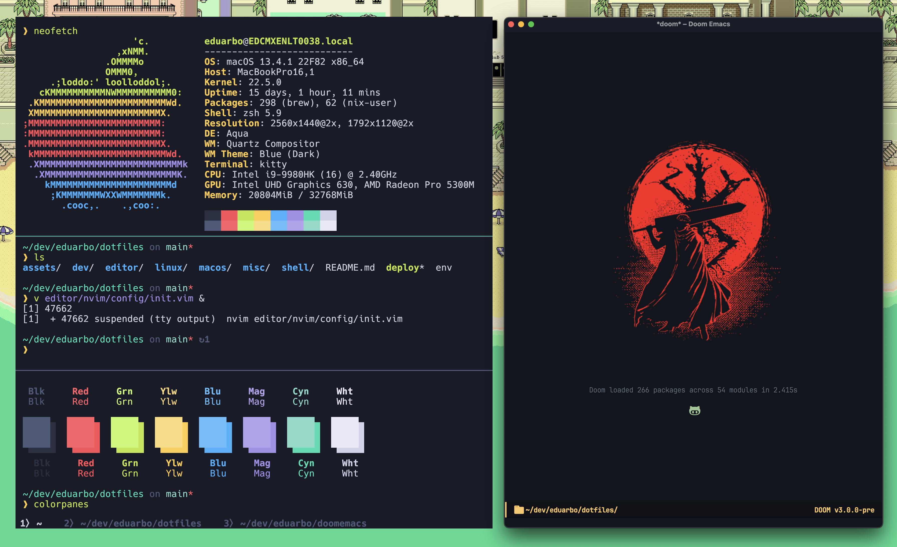
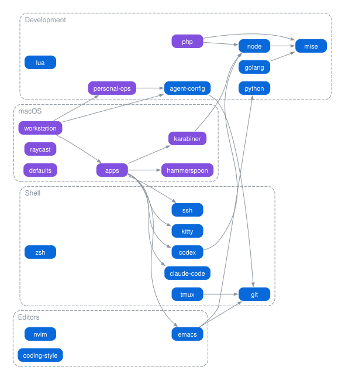
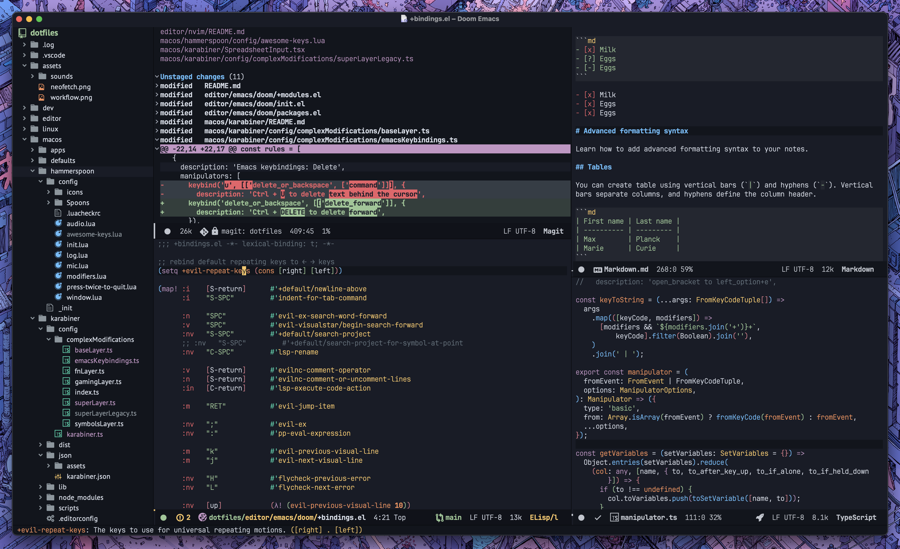

# dotfiles

My macOS and Debian setup, split into small **topics** that install, link and update
themselves. A tidy `$HOME` is a tidy mind.



## Quick start

```sh
git clone --recurse-submodules https://github.com/eduarbo/dotfiles.git ~/dev/eduarbo/dotfiles
cd ~/dev/eduarbo/dotfiles
./deploy shell/zsh       # the first topic; afterwards the `dot` alias exists
dot macos/workstation    # the whole personal Mac profile
```

Clone it anywhere: topics are linked from wherever the repository lives. You need git,
zsh and curl, plus [Homebrew](https://brew.sh/) on macOS. It runs on Apple Silicon and
Intel Macs and on Debian 12.

## Topics

Every folder below is a topic. `dot TOPIC` installs it after the topics it depends on;
📖 marks the ones with their own guide.

### macOS

| Topic | What it does |
| --- | --- |
| [`workstation`](macos/workstation) 📖 | One command for the whole personal Mac profile, plus `workstation-doctor` |
| `apps` | Desktop apps and CLIs I can't live without, through Homebrew and the App Store |
| `defaults` | Opinionated macOS defaults for a saner system (`macosdefaults`) |
| [`hammerspoon`](macos/hammerspoon) 📖 | Window management, a Hyper app launcher and sound-output switching |
| [`karabiner`](macos/karabiner) 📖 | Turns the MacBook keyboard into my 36-key layout |
| [`raycast`](macos/raycast) 📖 | Encrypted Raycast snapshot with export and import helpers |

### Shell

| Topic | What it does |
| --- | --- |
| `zsh` | zinit, Powerlevel10k and a `bin/` of small utilities |
| [`git`](shell/git) 📖 | Aliases, hooks and isolated, signed GitHub accounts |
| [`ssh`](shell/ssh) 📖 | Bitwarden SSH agent and machine-local hosts |
| [`kitty`](shell/kitty) 📖 | Terminal with vi mode, a custom theme and safe remote control |
| `tmux` | Terminal multiplexer config |
| [`claude-code`](shell/claude-code) 📖 | Claude Code with a Powerlevel10k-style status line |
| [`codex`](shell/codex) 📖 | Codex CLI through the managed Node toolchain |

### Editors

| Topic | What it does |
| --- | --- |
| [`emacs`](editor/emacs) 📖 | Doom Emacs with Evil, plus my keybindings |
| [`nvim`](editor/nvim) 📖 | Neovim for quick edits, mirroring Doom's bindings where possible |
| `coding-style` | EditorConfig, ESLint, Prettier and Stylelint defaults |

### Development

| Topic | What it does |
| --- | --- |
| `mise` | Version manager for Node, Python, Lua and more |
| `node` | npm and pnpm packages; mise owns the runtime |
| `python` | pipx tools; mise owns the runtime |
| `golang` | Go and a few must-have packages |
| `lua` | Lua, LuaRocks packages and luacheck |
| `php` | PHP with Composer |
| [`agent-config`](dev/agent-config) 📖 | Bootstraps and audits my AI agent configuration repositories |
| [`personal-ops`](dev/personal-ops) 📖 | Clones and validates my Personal Ops control plane |

## How the topics depend on each other

`dot macos/workstation` walks this graph and installs each dependency first. Purple topics
are macOS-only and are skipped on Debian.



## Everyday commands

| Command | Does |
| --- | --- |
| `dot TOPIC…` | Install or update topics; accepts `shell`, `'editor/*'` or `-A` for everything |
| `dot -l TOPIC` | Relink only, without running install scripts |
| `dot -d TOPIC` | Disable a topic and clean up after it |
| `dot -t TOPIC` | Dry run: print what would happen |
| `dot -L` | List enabled topics |

[How `dot` works and how to add a topic →](docs/deploy.md)

## Secrets stay on the machine

Nothing secret is committed. Tokens, keys, hostnames and account details live under
`~/.config` on each machine:

- GitHub accounts and signing keys: [`git account`](shell/git/README.md)
- Private SSH hosts: `~/.config/ssh/local.conf` ([ssh](shell/ssh/README.md))
- Forge tokens for Magit: `authinfo.gpg` ([emacs](editor/emacs/README.md#forge-tokens))
- Raycast: an encrypted snapshot behind your export password ([raycast](macos/raycast/README.md))

## More

- [Managing topics](docs/deploy.md) and [troubleshooting](docs/troubleshooting.md)
- [My keyboard layout](https://github.com/eduarbo/qmk_userspace/blob/main/users/eduarbo/README.md),
  shared by the Piantor, the Corne and Karabiner
- Built on [hlissner/dotfiles](https://github.com/hlissner/dotfiles),
  [Doom Emacs](https://github.com/doomemacs/doomemacs) and
  [Powerlevel10k](https://github.com/romkatv/powerlevel10k)

<details>
<summary>More screenshots</summary>



</details>
