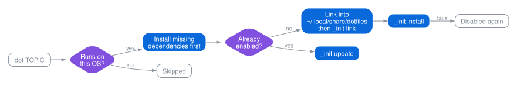

[dotfiles](../README.md) › docs › deploy

# Managing topics with `dot`

`deploy` is the topic manager, based on
[hlissner's](https://github.com/hlissner/dotfiles). Run it as `./deploy` on a fresh clone;
once `shell/zsh` is enabled it is also the `dot` alias.

## What `dot TOPIC` does



An enabled topic is just a symlink: `~/.local/share/dotfiles/shell.zsh.topic` points at
`shell/zsh` in this repository, so `dot -L` lists those links.

## Options

```text
Usage: dot [-AacdfhlLit] [TOPIC...]

  -A   All topics supported on this OS (shell bootstrap first)
  -a   All enabled topics (ignores TOPIC)
  -c   Afterwards, remove dead symlinks and empty dot-directories in $HOME; works alone
  -d   Disable and unlink topics, running their clean()
  -f   Force install and link
  -l   Only enable and relink topics (implies -i)
  -L   List enabled topics
  -i   Skip the install, update and clean scripts
  -t   Test run: print what would happen
```

`TOPIC` can be exact (`shell/zsh`), a whole group (`shell`) or a glob (`'editor/*'`).
Groups and globs only include topics that support the current OS.

| Example | Does |
| --- | --- |
| `dot shell/zsh shell/kitty` | Enable two topics |
| `dot shell` | Enable every shell topic for this OS |
| `dot -A` | Enable everything for this OS |
| `dot -a` | Update every enabled topic |
| `dot -f macos/karabiner` | Re-run install and link for an enabled topic |
| `dot -l` | Relink every enabled topic |
| `dot -d shell/zsh` | Disable a topic and clean up after it |

## Anatomy of a topic

```text
category/topic/
├── _init         required: OS support, dependencies and lifecycle functions
├── env.zsh       sourced by .zshenv in every shell
├── config.zsh    sourced by .zshrc in interactive shells
├── aliases.zsh   sourced by .zshrc after config.zsh
├── bin/          added to PATH
└── config/       files that _init link places, usually under ~/.config
```

Only `_init` is required. The shell files and `bin/` are picked up from every enabled
topic, so a topic never edits `.zshrc` itself.

## Add a topic

```zsh
#!/usr/bin/env zsh
source ${0:A:h}/../../deploy

os=(macos debian)           # where it runs; use (all) for any OS
deps=(shell/git)            # topics to enable first

link()    { mklink config $XDG_CONFIG_HOME/mytool }
install() { brew install mytool }
update()  { brew install mytool }
clean()   { rm -fv $XDG_CONFIG_HOME/mytool }

init "$@"
```

Save it as `category/mytool/_init`, make it executable and run `dot category/mytool`.
`mklink` resolves sources relative to the topic, and `_os`, `_is_callable` and the
`echo-*` helpers come from [`env`](../env) and [`deploy`](../deploy).
