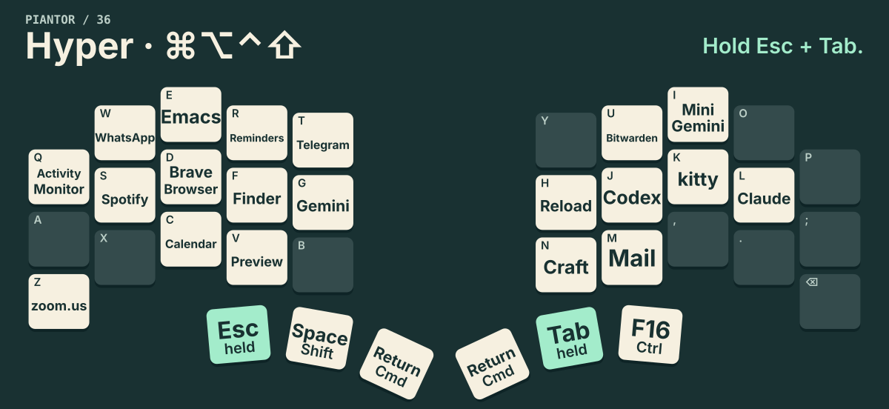

[dotfiles](../../README.md) › macos › hammerspoon

# Hammerspoon

Lua automation for window management, an app launcher, sound output and a few safety
nets. The hotkeys use the Super (`⌘⌥⌃`) and Hyper (`⌘⌥⌃⇧`) chords of my
[keyboard layout](https://github.com/eduarbo/qmk_userspace/blob/main/users/eduarbo/README.md),
which work the same on the MacBook through [Karabiner](../karabiner).

```sh
dot macos/hammerspoon
```

## App launcher

Hold Hyper and tap a letter to open or focus that app.

<picture>
  <source media="(max-width: 600px)" srcset="docs/launcher-mobile.svg">
  
</picture>

On the MacBook, hold the printed **left ⌥** and **right ⌘** for Hyper. macOS reserves Hyper with comma or period for sysdiagnose.

To update the maps, edit [`config/bindings.lua`](config/bindings.lua) and run `python3 docs/draw_launcher.py` here. The generator uses the Piantor renderer from a sibling [qmk_userspace checkout](https://github.com/eduarbo/qmk_userspace). Set `QMK_USERSPACE` if yours is elsewhere. Switch positions come from [beekeeb’s Piantor PCB](https://github.com/beekeeb/piantor/tree/cd847afb4f9a86e8c1c8e36f243140644013afb2/pcb) ([GPLv3](https://github.com/eduarbo/qmk_userspace/blob/main/docs/cover/COPYING)).

## Other hotkeys

| Hotkey | Action |
| --- | --- |
| Super `H` / `L` | Window to the left / right half; repeat for ⅓ and ⅔ |
| Super `K` | Maximize the window or restore it |
| Super `J` | Move the window to the next screen |
| Super `;` | Window grid |
| Super `Y` | Switch the sound output |
| `⌘Q` twice | Quit the app; once only shows a warning |
| `⌘F16` or `⌘Esc` | Lock the screen |
| `⇧F16` | Emoji picker |

The rest of Super's keys are in the
[Super layer diagram](https://github.com/eduarbo/qmk_userspace/blob/main/users/eduarbo/README.md#super--hold-esc).

A menu bar icon mutes and unmutes the mic. Its push-to-talk hotkey is off; enable it in
`config/bindings.lua`.

The config reloads itself when a file in `config/` changes.
