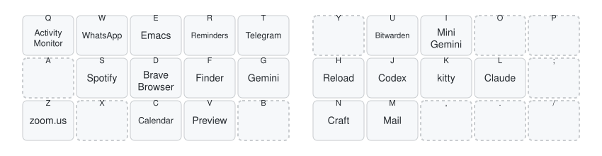

[dotfiles](../../README.md) › macos › hammerspoon

# Hammerspoon

Lua automation for window management, an app launcher, sound output and a few safety
nets. The hotkeys use the Super (`⌘⌥⌃`) and Hyper (`⌘⌥⌃⇧`) chords of my
[keyboard layout](https://github.com/eduarbo/qmk_userspace/blob/main/users/eduarbo/README.md),
which work the same on the MacBook through [Karabiner](../karabiner).

```sh
dot macos/hammerspoon
```

## App launcher

Hold Hyper and tap a letter to open or focus an app. Gemini is a Raycast hotkey, and `,`
and `.` stay free because macOS uses them for sysdiagnose.



Edit the list in [`config/bindings.lua`](config/bindings.lua), then redraw the diagram with
`python3 docs/draw_launcher.py`.

## Other hotkeys

| Hotkey | Action |
| --- | --- |
| Super `H` / `L` | Window to the left / right half; repeat for ⅓ and ⅔ |
| Super `K` | Maximize the window or restore it |
| Super `J` | Move the window to the next screen |
| Super `;` | Window grid |
| Super `Y` | Switch the sound output |
| `⌘Q` twice | Quit the app; once only shows a warning |
| `⌘F16` or `⌘Esc` | Lock the screen |
| `⇧F16` | Emoji picker |

Raycast owns the rest of Super's right hand: `U` Bitwarden, `I` Gemini, `O` clipboard
history, `M` emoji, `,` snippets and `.` universal actions.

A menu bar icon mutes and unmutes the mic. Its push-to-talk hotkey is off; enable it in
`config/bindings.lua`.

The config reloads itself when a file in `config/` changes.
