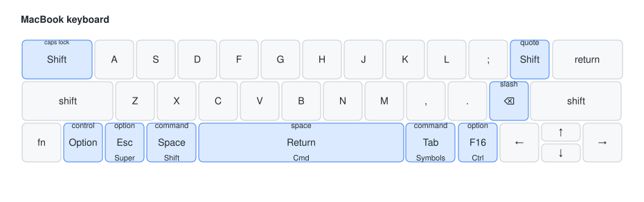

[dotfiles](../../README.md) › macos › karabiner

# Karabiner-Elements config

Makes the MacBook keyboard type like my 36-key
[QMK layout](https://github.com/eduarbo/qmk_userspace/blob/main/users/eduarbo/README.md)
(Piantor and Corne), so switching keyboards needs no relearning. The config is generated
from TypeScript.

Highlighted keys are remapped. The small top legend is the printed key; the middle one is
the tap and the bottom one the hold.

## Layers

The layers match the [QMK diagrams](https://github.com/eduarbo/qmk_userspace/blob/main/users/eduarbo/README.md#layers)
key for key. On the MacBook you reach them like this:

| Layer | Hold |
| --- | --- |
| Symbols | Right ⌘ |
| Super (`⌘⌥⌃`) | Left ⌥ |
| Hyper (`⌘⌥⌃⇧`) | Left ⌥ and right ⌘, in either order |
| FN (F-Keys) | Left ⌥, then the space bar or right ⌥ |

Hyper is also my app launcher: see [Hammerspoon](../hammerspoon/README.md#app-launcher).

A few things differ from QMK:

- `Symbols+Z` sends Caps Lock; QMK uses Caps Word.
- Super with the space bar reaches FN, because the space bar is easier to reach than the
  ⌘ key that plays the Space thumb.
- There is no Adjust layer: firmware controls and layout toggles only exist in QMK.
- The Super layer has no device condition, so it also turns `Super+Q/A/Z/X/C/V/B` from the
  QMK keyboards into the screenshot and app-switching shortcuts.

## App-specific rules

**Emacs-style editing** works everywhere except editors, terminals, games, virtual
machines, remote desktops and X11 apps:

| Shortcut | Action |
| --- | --- |
| `⌃W` / `⌃U` / `⌃D` | Delete the previous word / to line start / to line end |
| `⌃B` / `⌃F` | Move one word back / forward |
| `⌃⌫` | Delete forward |

**Civilization V** gets a one-handed layer on every keyboard while the game is in front:

| Key | Sends | Key | Sends |
| --- | --- | --- | --- |
| `Q` | `⌫` | `F` | `.` (next unit) |
| `W` | `Home` (previous city) | `G` | `M` (move) |
| `R` | `End` (next city) | `Z` | `F` (fortify) |
| `T` | `U` (upgrade) | `X` | `H` (heal) |
| `S` | `,` (previous unit) | `C` | `S` (set up artillery) |
| `D` | `F3` | `V` | `⌃A` (attack) |

Tapping right ⌘ sends `⇧Return` (next turn).

## Development

| Command | Does |
| --- | --- |
| `npm run build` | Generates `json/` and makes Karabiner reload the deployed config |
| `npm test` | Runs the tests, including parity with the QMK userspace |
| `npm run docs` | Redraws `docs/macbook.svg` from `docs/macbook.yaml` |
| `npm run prettier` | Formats the sources |

- **Deploy:** `./_init link` symlinks `json/karabiner.json` into `~/.config/karabiner`. Saving
  settings in the Karabiner app replaces that symlink with a regular file; `link` backs the
  file up and restores the symlink.
- **Parity test:** it reads `~/dev/eduarbo/qmk_userspace` (set `QMK_USERSPACE` for another
  path) and is skipped when that checkout is missing. Run it after changing either side.
- **Rule order:** Karabiner uses the first rule that matches, so app-specific and chord rules
  come before the base layer in `config/karabiner.ts`.
