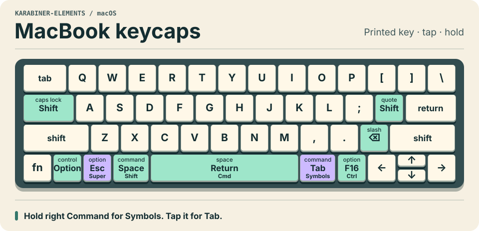

[dotfiles](../../README.md) › macOS › Karabiner

# My 36-key layout on the MacBook

My Piantor and Corne have six thumb keys. On the MacBook, the space bar stands in for both inner thumbs. Tap it for Return, hold it for Command. The two Command and two Option keys take the other four jobs.

**[Find a character or shortcut](https://github.com/eduarbo/qmk_userspace/blob/main/users/eduarbo/README.md#find-a-key)** · [All layer maps](https://github.com/eduarbo/qmk_userspace/blob/main/users/eduarbo/README.md#layers) · [App-specific rules](#app-specific-rules)

<picture>
  <source media="(max-width: 600px)" srcset="docs/macbook-mobile.svg">
  
</picture>

On each highlighted key the small top label is the **printed keycap**, the center is the **tap**, and the bottom is the **hold**. A single action applies on press.

## Layers

| I want… | Hold these printed MacBook keys |
| --- | --- |
| Symbols · digits, punctuation and arrows | **Right ⌘** |
| Super · browser, screenshot and window shortcuts | **Left ⌥** |
| Hyper · [my app launcher](../hammerspoon/README.md#app-launcher) | **Left ⌥ + right ⌘**, either order, then tap a letter |
| FN · function keys, media and brightness | **Left ⌥ first**, then the **space bar** or **right ⌥** |

### MacBook rollover and Shift

Some simultaneous combinations don't register on my built-in keyboard. To work around that rollover limit, I can keep **right ⌘** held for Symbols and choose a Shift on either side of the home row. Try these two gestures with the same key:

- **Type ñ** on the U.S. input layout. Hold **right ⌘**, tap **;**, release **right ⌘**, then type **N**.
- **Type an underscore**. Hold **right ⌘** and **;**, tap **B**, then release both. For the other hand, hold **A** in place of **;** and tap **U** for **{**.

<picture>
  <source media="(prefers-reduced-motion: reduce)" srcset="https://raw.githubusercontent.com/eduarbo/qmk_userspace/main/docs/symbols-tap-hold.svg">
  <source media="(max-width: 600px)" srcset="https://raw.githubusercontent.com/eduarbo/qmk_userspace/main/docs/gestures/macbook-symbols-mobile.gif">
  
</picture>

Both holds send left Shift. On the base, the printed **Caps Lock** and **quote** keys are extra left and right Shift keys. The [shared Symbols guide](https://github.com/eduarbo/qmk_userspace/blob/main/users/eduarbo/README.md#macbook-rollover-and-shift) shows the tap/hold diagram and character lookup.

### What changes on the laptop

- **Caps.** Symbols + `Z` toggles macOS Caps Lock. The splits use QMK Caps Word there.
- **Thumb shortcuts.** Hold the **space bar** and tap **left ⌘** to send ⌘Space. Hold **right ⌘** and tap the **space bar** to send ⌘Return.
- **Profiles.** Both Default profiles contain the layout. The one labeled “disable built-in kbd” also disables the laptop keyboard when a matching Corne or Piantor is connected. **Empty** has no custom rules.
- **External keyboards.** Firmware settings, Winux and Gamepad live on the QMK boards. Karabiner's Super rule also handles `Q A Z X C V B` from those boards, so the screenshot and app-switching shortcuts work when I plug a split into my Mac.

## App-specific rules

**Emacs-style editing** works everywhere except editors, terminals, games, virtual
machines, remote desktops and X11 apps:

| Shortcut | Action |
| --- | --- |
| `⌃W` / `⌃U` / `⌃D` | Delete the previous word / to line start / to line end |
| `⌃B` / `⌃F` | Move one word back / forward |
| `⌃⌫` | Delete forward |

**Civilization V** gets a one-handed layer on every keyboard while the game is in front:

| Key | Sends | Key | Sends |
| --- | --- | --- | --- |
| `Q` | `⌫` | `F` | `.` (next unit) |
| `W` | `Home` (previous city) | `G` | `M` (move) |
| `R` | `End` (next city) | `Z` | `F` (fortify) |
| `T` | `U` (upgrade) | `X` | `H` (heal) |
| `S` | `,` (previous unit) | `C` | `S` (set up artillery) |
| `D` | `F3` | `V` | `⌃A` (attack) |

Tapping right ⌘ sends `⇧Return` (next turn).

## Development

From `macos/karabiner`, use the Node version in [.node-version](.node-version) and install dependencies with `npm ci`. The TypeScript [rules and profile order](config/karabiner.ts) generate the checked-in JSON.

| Command | Does |
| --- | --- |
| `npm run build` | Generates `json/` and deploys it to Karabiner |
| `npm test` | Runs the tests, including parity with the QMK userspace |
| `npm run docs` | Redraws both MacBook maps from the YAML legends and JSON positions |
| `npm run prettier` | Formats the sources |

- **Deploy:** the build copies `json/karabiner.json` to `~/.config/karabiner` and keeps the
  profile selected in Karabiner's menu; Karabiner reloads it on its own. Edit the TypeScript,
  not Karabiner's settings, because the next build replaces them.
- **Parity test:** it compares the thirty finger-key positions on Base, Symbols and FN. It reads `~/dev/eduarbo/qmk_userspace` (set `QMK_USERSPACE` for another
  path) and is skipped when that checkout is missing. Run it after changing either side.
- **Rule order:** Karabiner uses the first rule that matches, so app-specific and chord rules
  come before the base layer in `config/karabiner.ts`.
