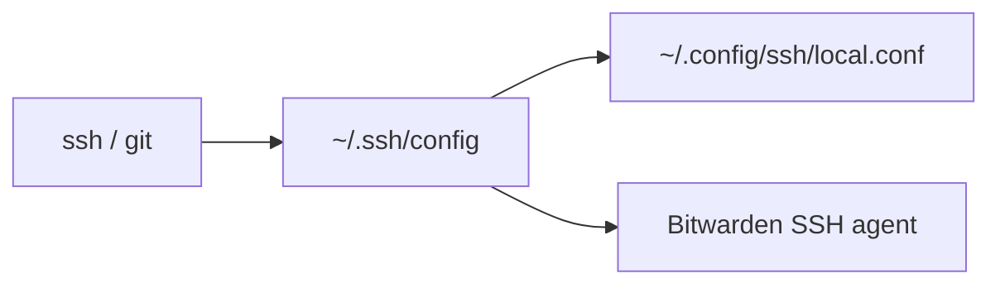

[dotfiles](../../README.md) › shell › ssh

# SSH

An SSH client config that takes keys from the Bitwarden SSH agent and keeps
machine-specific hosts out of this public repository.

```sh
dot shell/ssh
```



## What it sets up

- **Keys from Bitwarden:** every host uses the Bitwarden agent, and GitHub never falls back
  to key files on disk. On macOS the install checks that Bitwarden is recent enough.
- **Private hosts:** `~/.config/ssh/local.conf` is created empty with mode `600` and
  included first. Put hostnames, users, proxies and keys for private machines there.
- **`ssh-agent-check`:** inspects the effective config and the agent socket without
  listing keys, unlocking the vault or contacting a server.
- **`cloudflared-ssh-service HOST`:** a `ProxyCommand` for hosts behind Cloudflare Access.
  It reads `keychain_service_prefix` from `~/.config/ssh/cloudflared-service.conf` and uses
  the matching Keychain service token; without one it falls back to the browser login.
  `cloudflared` is installed only when `local.conf` uses it.

## Local keys

If you prefer a key file over Bitwarden, create one without a device name or email in
its public comment:

```sh
ssh-keygen -t ed25519 -C ""
```

For several GitHub accounts, use the profiles in [`shell/git`](../git/README.md) instead of
editing this config. `dot -d shell/ssh` removes the links but keeps `local.conf`, local keys
and account data.
